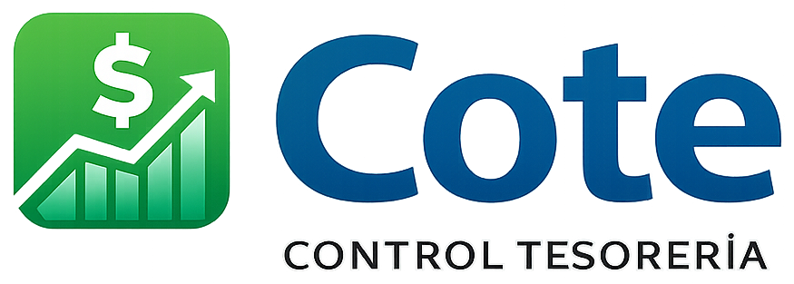

# COTE

<p align="center">
  
</p>

<p align="center">
  <strong>Control de Tesorería</strong>
</p>

<p align="center">
  Aplicación web para la gestión de tesorería: cuentas, personas, transacciones, rendiciones y aprobaciones.
</p>

---

## Características

Control de caja chica: la empresa ingresa dinero a Tesorería, Tesorería lo entrega a los trabajadores, ellos rinden sus gastos con fotos de las boletas o facturas y devuelven lo que sobra. Cada peso queda trazado.

- **Ingreso a caja chica** — Registro del dinero que entra a Tesorería, con su origen y aprobación
- **Entregas y devoluciones** — Transferencias Tesorería ↔ trabajador, aprobadas antes de mover saldos
- **Rendiciones** — Gastos con fecha y monto de cada comprobante; foto o PDF obligatorio (excepción con motivo)
- **Aprobaciones** — Confirmación con el detalle a aprobar; una rendición aprobada ya no se edita ni elimina
- **Saldos claros** — Por trabajador: *Por rendir* (tiene dinero de la empresa) o *Se le debe* (gastó de su bolsillo)
- **Cartola por cuenta** — Movimientos con saldo resultante; marca el saldo que ningún movimiento respalda
- **Cierre de mes** — Resumen por cuenta, arqueo de Tesorería y foto fija del mes cerrado
- **Permisos** — Jefe y tesorero gestionan todo; cada trabajador ve solo sus rendiciones y su cuenta
- **Estadísticas e informes** — Gráficos por persona y categoría, exportación a Excel
- **Modo oscuro** — En la app y en el login, con la preferencia recordada

## Stack

| Tecnología        | Uso                    |
|-------------------|------------------------|
| **Laravel 12**    | Backend, API, auth     |
| **Livewire 3**    | Componentes reactivos  |
| **Laravel Breeze**| Login y sesión         |
| **Bootstrap 5**   | UI y componentes       |
| **DataTables**    | Tablas avanzadas      |
| **Spatie**        | Permisos, activity log, medialibrary |
| **Laravel Sail**  | Entorno Docker         |

La app no usa CDNs ni servicios externos: Bootstrap, jQuery, DataTables, Font Awesome, toastr, Chart.js y la fuente Figtree se sirven desde el propio servidor, así que funciona en una red local sin internet. Las librerías de interfaz están en `public/vendor/`; para actualizarlas, edita las versiones en `scripts/vendor-assets.sh` y ejecútalo (verifica cada archivo con su hash SHA-384).

## Requisitos

- PHP 8.2+
- Composer
- Node.js y npm (para assets)
- Base de datos: SQLite (desarrollo) o PostgreSQL (producción)

## Instalación

### Con Laravel Sail (Docker)

```bash
# Clonar el repositorio
git clone https://github.com/roro66/cote.git
cd cote

# Instalar dependencias PHP
composer install

# Copiar entorno y configurar (editar .env si es necesario)
cp .env.example .env
php artisan key:generate

# Levantar contenedores
./vendor/bin/sail up -d

# Migraciones y seeders
./vendor/bin/sail artisan migrate
./vendor/bin/sail artisan db:seed

# Assets (dentro del contenedor)
./vendor/bin/sail npm install
./vendor/bin/sail npm run build
```

La aplicación quedará disponible en `http://localhost` (o el puerto configurado en `APP_PORT` en `.env`).

### Sin Docker

```bash
composer install
cp .env.example .env
php artisan key:generate
# Configurar DB en .env (por defecto SQLite)
php artisan migrate
php artisan db:seed
npm install && npm run build
php artisan serve
```

## Datos iniciales

`php artisan db:seed` (o `sail artisan db:seed`) carga solo datos base y se puede repetir sin riesgo: roles, bancos, tipos de cuenta, categorías de gasto, la cuenta Tesorería en $0 y dos usuarios:

| Email | Rol |
|-------|-----|
| `admin@cote.com` | boss (jefe) |
| `tesorero@cote.com` | treasurer (tesorero) |

La contraseña se toma de `COTE_BOSS_PASSWORD` y `COTE_TREASURER_PASSWORD` en `.env`; si no están, se genera una al azar y se muestra una sola vez en la consola. Los emails se pueden cambiar con `COTE_BOSS_EMAIL` y `COTE_TREASURER_EMAIL`.

Para desarrollo local hay personas de ejemplo con su cuenta en $0: `php artisan db:seed --class=DemoDataSeeder`. Los saldos se generan usando la app (ingreso → entrega → rendición), así siempre cuadran.

## Donaciones

Se aceptan donaciones de cualquier monto para apoyar el desarrollo y mantenimiento de COTE. Gracias desde ya por tu aporte.

[](https://www.paypal.com/donate/?hosted_button_id=4WY2DYMZL2HBW)

**[Donar con PayPal](https://www.paypal.com/donate/?hosted_button_id=4WY2DYMZL2HBW)**

## Licencia

Este proyecto está bajo la [licencia MIT](https://opensource.org/licenses/MIT).
